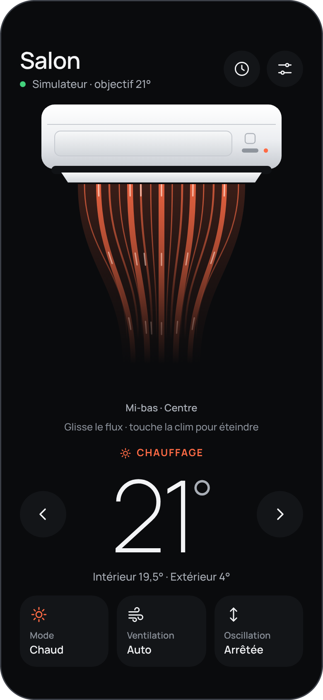
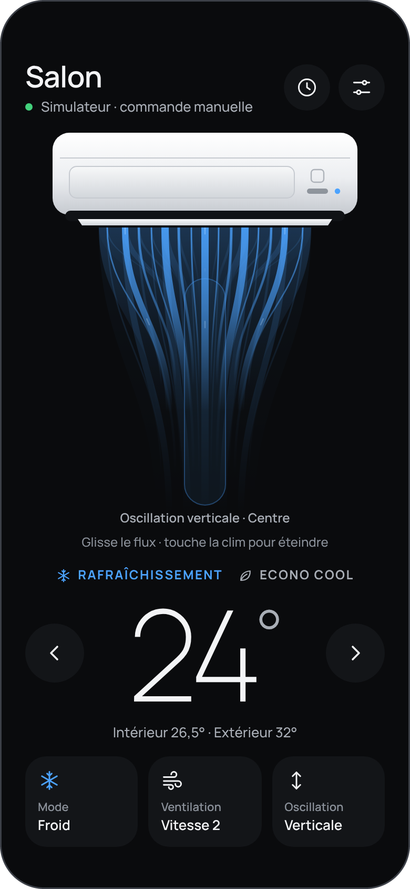
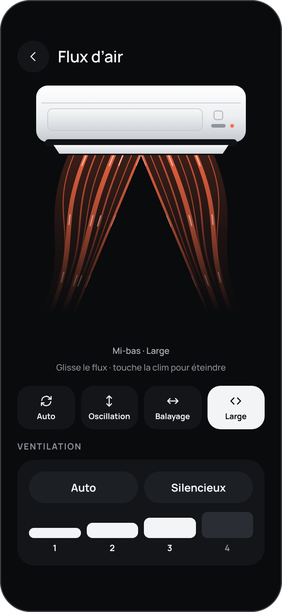
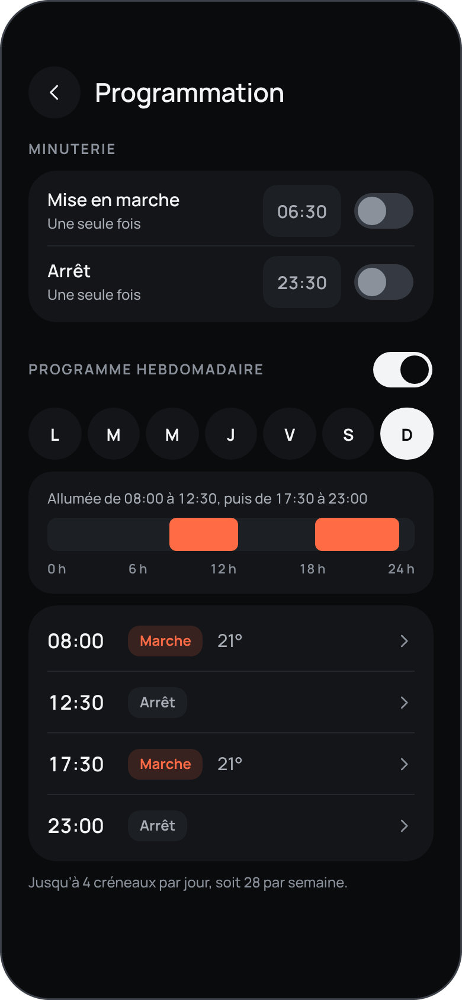
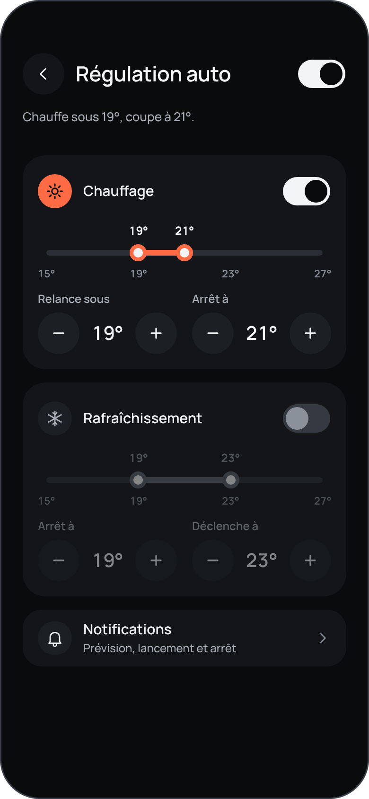
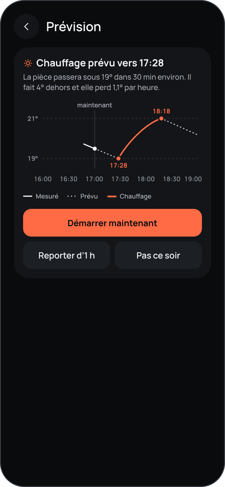
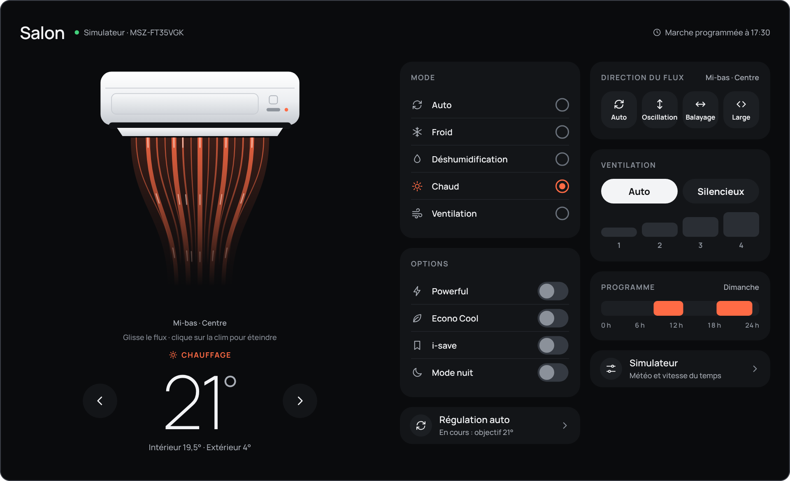

# Climatisation Mitsubishi

Appli web installable (PWA) et serveur Node pour piloter une climatisation Mitsubishi Electric **MSZ-FT** depuis le
téléphone et le PC, en local : pas de compte cloud, pas de matériel à ajouter.

- **Avec le serveur**, l'appli pilote la vraie unité par son interface Wi-Fi intégrée et partage le même état entre
  tous les appareils du réseau.
- **Sans serveur**, elle tourne seule dans le navigateur avec une clim simulée : pratique pour développer et tester.

## Aperçu

<p align="center">
  
  
  
</p>
<p align="center"><em>Accueil en chauffage et en rafraîchissement, réglage du flux d'air.</em></p>

<p align="center">
  
  
  
</p>
<p align="center"><em>Programmation hebdomadaire, régulation automatique, prévision du prochain démarrage.</em></p>

<p align="center">
  
</p>
<p align="center"><em>Tableau de bord sur grand écran. Captures prises avec la clim simulée.</em></p>

## Fonctionnalités

- **Accueil** : l'unité et son jet d'air. Glisser le doigt oriente le flux (5 × 5 positions de volets), toucher
  l'unité l'allume ou l'éteint. Consigne, températures, raccourcis.
- **Jet d'air animé** : la vitesse, la densité et l'éclat des filets d'air suivent la puissance, du mode Silencieux
  à Powerful.
- **Flux d'air** : hauteur automatique, oscillation, balayage, soufflage large, vitesse de ventilation.
- **Modes** : Auto, Froid, Déshumidification, Chaud, Ventilation.
- **Options** : Powerful, Econo Cool, i-save et mode nuit, pilotées par l'appli (voir plus bas).
- **Programmation** : minuterie et programme hebdomadaire (4 créneaux par jour), avec copie d'un jour sur toute la
  semaine.
- **Régulation automatique** : thermostat à hystérésis avec prévision du prochain déclenchement.
- **Notifications push** : avant un démarrage, au lancement et à l'arrêt, reçues par le système même appli fermée.
  Rien ne s'affiche dans l'appli elle-même.
- **Tableau de bord** : au-delà de 980 px de large, tout tient sur un seul écran.

## Prérequis

- Node.js 22 ou plus récent.
- Pour la vraie clim : une unité dont l'interface Wi-Fi d'origine est connectée au réseau local (appairage WPS).

## Démarrage rapide (simulateur)

```bash
npm install
npm run dev        # http://localhost:5173
npm run dev:lan    # même chose, joignable depuis un téléphone sur le même Wi-Fi
```

L'écran **Simulateur** règle la température extérieure, celle de la pièce et la vitesse du temps (×1, ×10, ×60)
pour voir une soirée de régulation en une minute. L'état est enregistré dans le navigateur (`localStorage`).
Les notifications partent du serveur : avec la clim simulée, aucune n'est envoyée.

## Piloter la vraie clim

```bash
npm run demarrer   # construit l'appli et le serveur, puis lance le serveur
npm run serveur    # relance le serveur sans reconstruire
```

Au premier lancement, le serveur crée `clim.config.json` à la racine (modèle : `clim.config.example.json`) :

| Clé       | Rôle                                                                              |
| --------- | --------------------------------------------------------------------------------- |
| `clim`    | Adresse IP de l'unité sur le réseau local                                         |
| `port`    | Port du serveur (8787 par défaut)                                                 |
| `meteo`   | Latitude et longitude utilisées pour la température dehors                        |
| `https`   | Port, certificat et clé d'un accès HTTPS en plus (`null` : éteint), voir plus bas |
| `contact` | Adresse `https:` ou `mailto:` transmise aux services de push avec chaque envoi    |

`node outils/trouver-clim.mjs` cherche l'unité sur le réseau et affiche son adresse. Un bail DHCP fixe évite
qu'elle change.

Le serveur tourne sur une machine qui reste allumée. Il :

- relit l'état de l'unité toutes les 10 secondes et lui envoie les ordres (`server/LocalClim.ts`) ;
- fait tourner la régulation, le programme et la prévision en continu ;
- envoie les notifications push aux appareils abonnés, ce qui lui demande un accès à Internet ;
- sert l'appli sur `http://localhost:8787` et sur `http://<ip-de-la-machine>:8787` pour le reste du réseau ;
- prend la température extérieure sur [Open-Meteo](https://open-meteo.com/), l'unité n'en fournissant pas.

Ses réglages sont conservés dans `clim.state.json`. Les deux fichiers sont propres à chaque installation et
ignorés par git.

### Installer l'appli

- **PC (Chrome ou Edge)** : ouvrir l'adresse du serveur, puis l'icône d'installation dans la barre d'adresse.
- **iPhone** : ouvrir l'adresse dans Safari, puis Partager → « Sur l'écran d'accueil ».
- Le mode hors ligne et les notifications push demandent HTTPS ou `localhost`.

### Notifications push

Le serveur prévient chaque appareil abonné avant un démarrage prévu, au lancement automatique et à l'arrêt. Le
message part chiffré vers le service de push du navigateur (Apple, Google ou Mozilla), qui le remet à l'appareil
même appli fermée : pas de compte à créer, et rien ne s'affiche dans l'appli.

Chaque appareil s'abonne depuis **Régulation → Notifications → Notifications push**. Une notification de
bienvenue confirme que la chaîne fonctionne. Sur le même écran, « Recevoir sur » coupe d'un coup tous les
téléphones ou tous les PC.

- **PC** : rien à préparer, `http://localhost:8787` suffit.
- **Téléphone** : il faut l'appli installée et servie en HTTPS, avec un certificat que le téléphone accepte.
  iOS 16.4 au minimum.
- Toucher une prévision ouvre l'écran **Prévision** (courbe, « Démarrer maintenant », « Reporter d'1 h »,
  « Pas ce soir »). Avec Chrome ou Edge, sur PC et Android, les deux premiers choix sont aussi des boutons de la
  notification.
- Une prévision déjà annoncée n'est pas répétée avant deux fois le délai choisi, sauf si un cycle a tourné
  entre-temps.

Pour le HTTPS, [mkcert](https://github.com/FiloSottile/mkcert) crée un certificat reconnu sur le réseau local.
Sur le PC du serveur, à la racine du projet, avec l'adresse IP de ce PC :

```bash
mkcert -install
mkdir certs
mkcert -cert-file certs/clim.pem -key-file certs/clim-key.pem 192.168.1.20 localhost
```

Puis dans `clim.config.json` :

```json
"https": { "port": 8443, "cert": "certs/clim.pem", "key": "certs/clim-key.pem" }
```

Sur l'iPhone :

1. Envoyer au téléphone le fichier `rootCA.pem` du dossier donné par `mkcert -CAROOT`, puis installer le profil.
2. Réglages → Général → Informations → Réglages de confiance des certificats : activer ce certificat.
3. Ouvrir `https://192.168.1.20:8443` dans Safari, puis Partager → « Sur l'écran d'accueil ».
4. Lancer l'appli depuis son icône et activer les notifications push.

Le dossier `certs/` est ignoré par git. Un bail DHCP fixe pour le PC évite de refaire le certificat.

## Scripts

| Commande               | Rôle                                                  |
| ---------------------- | ----------------------------------------------------- |
| `npm run dev`          | Appli en développement, avec la clim simulée          |
| `npm run build`        | Vérifie les types puis construit l'appli dans `dist/` |
| `npm run build:server` | Construit le serveur dans `dist-server/`              |
| `npm run demarrer`     | Construit tout, puis lance le serveur                 |
| `npm run preview`      | Sert la version construite de l'appli                 |
| `npm test`             | Tests unitaires (Vitest)                              |
| `npm run lint`         | Analyse statique (oxlint)                             |
| `npm run typecheck`    | TypeScript seul                                       |
| `npm run format`       | Met en forme avec Prettier                            |
| `npm run check`        | Mise en forme, lint, types et tests, comme en CI      |

## Architecture

```
src/
  domain/      Règles pures, sans React ni navigateur
    types.ts          Modes, ventilation, volets, ordres envoyés à la clim
    capabilities.ts   Ce que sait faire l'unité (plages de consigne, durées)
    clim.ts           Effet de chaque ordre sur les réglages
    airflow.ts        Géométrie de la scène : glisser, caler, incliner le jet
    regulation.ts     Thermostat à hystérésis
    forecast.ts       Modèle thermique et prévision
    schedule.ts       Minuterie et programme hebdomadaire
    notify.ts         Textes et préférences des notifications
    push.ts           Message push échangé entre le serveur et l'appareil
  device/      Liaison avec la clim
    ClimDevice.ts     Interface que toute liaison respecte
    SimulatedClim.ts  Clim simulée
    mitsubishi.ts     Lecture et écriture des trames de l'unité
    clock.ts          Horloge réelle ou accélérée
  store/       État de l'appli
    controller.ts        AppController : programme, régulation, prévision, annonce des notifications
    RemoteController.ts  Même interface, branchée sur le serveur
    api.ts               Contrat commun et liste des actions exposées au réseau
    storage.ts           Enregistrement des réglages
    view.ts              Libellés et couleurs dérivés de l'état
  ui/          Composants (scène, panneaux, graphique de prévision) et table des routes
  screens/     Un fichier par écran
  services/    Abonnement push de l'appareil, détection de l'appareil
  worker/      Service worker : cache hors ligne, affichage des notifications push et de leurs actions
  lib/         Utilitaires sans dépendance
  styles/      Jetons de couleur et styles
server/
  main.ts       Assemblage : configuration, liaison, contrôleur, serveur HTTP
  api.ts        API JSON, flux d'événements (SSE) et fichiers de l'appli
  LocalClim.ts  Liaison locale avec l'unité
  smart.ts      Échange chiffré avec l'interface Wi-Fi
  push.ts       Abonnés aux notifications et envoi à chacun
  webPush.ts    Protocole Web Push : chiffrement du message et identification VAPID
  config.ts     Configuration, certificat HTTPS et état enregistrés sur disque
  weather.ts    Température extérieure
outils/        Recherche de l'unité sur le réseau
```

L'interface lit un instantané de l'état (`useApp()`) et appelle les actions du contrôleur (`useController()`).
`AppController` et `RemoteController` respectent le même contrat (`AppApi`) : l'interface ne sait pas si elle parle
au simulateur ou au serveur.

### API du serveur

| Route                           | Rôle                                                                                   |
| ------------------------------- | -------------------------------------------------------------------------------------- |
| `GET /api/snapshot`             | Instantané de l'état                                                                   |
| `GET /api/events`               | Flux d'événements (SSE), un instantané à chaque changement                             |
| `POST /api/action`              | `{ "name": "...", "args": [...] }`, limité aux actions listées dans `src/store/api.ts` |
| `GET /api/push/key`             | Clé publique VAPID du serveur                                                          |
| `POST /api/push/subscription`   | Abonne un appareil : `{ "endpoint": "...", "keys": {...}, "device": "phone" }`         |
| `DELETE /api/push/subscription` | Désabonne un appareil : `{ "endpoint": "..." }`                                        |

## Régulation et prévision

- Chauffage : relance sous le seuil bas, arrêt au seuil haut. Rafraîchissement : l'inverse.
- L'unité reçoit le seuil d'arrêt comme consigne et module elle-même sa puissance.
- Une marche dure au moins 5 minutes, le compresseur se repose 3 minutes, le mode opposé attend 1 heure.
- Un arrêt à la main met la régulation en pause pendant 1 heure.
- Unité éteinte, l'appli relève la température chaque minute, en déduit la perte de la pièce (loi de
  refroidissement de Newton) et estime l'heure du prochain déclenchement.

## Options

L'interface Wi-Fi ne transmet pas les options de la télécommande. L'appli les reproduit donc elle-même, avec les
seuls réglages que l'unité accepte : consigne, ventilation et volets (`src/domain/options.ts`).

| Option     | Effet                                                                                         |
| ---------- | --------------------------------------------------------------------------------------------- |
| Powerful   | Consigne poussée à la limite du mode et ventilation au maximum, jusqu'à la température voulue |
| Econo Cool | 2° de moins en chauffage, 2° de plus en froid, ventilation silencieuse                        |
| Mode nuit  | 1° de moins en chauffage, 1° de plus en froid, ventilation silencieuse                        |
| i-save     | Rappel d'un réglage favori (consigne, ventilation, volets), puis retour au réglage précédent  |

- La consigne affichée reste celle choisie : seul le réglage envoyé à l'unité change.
- Powerful s'arrête de lui-même quand la pièce atteint la consigne, au plus tard après une heure.
- Econo Cool et le mode nuit se cumulent, et décalent d'autant les seuils de la régulation automatique.
- Régler la ventilation à la main, ou changer un réglage à la télécommande, désactive ces options.
- Le serveur doit rester allumé pendant un Powerful : c'est lui qui rétablit le réglage normal. S'il s'arrête
  entre-temps, il le rétablit à son redémarrage.

## Protocole

L'interface Wi-Fi d'origine répond sur `http://<ip>/smart` à des requêtes XML chiffrées en AES-128-CBC. Le
protocole est repris du projet libre [pymitsubishi](https://github.com/pymitsubishi/pymitsubishi) ; les trames
produites par `src/device/mitsubishi.ts` sont vérifiées contre les siennes dans les tests.

Les notifications suivent le standard Web Push, écrit avec le seul module `crypto` de Node : message chiffré en
`aes128gcm` (RFC 8291) et serveur identifié par un jeton VAPID (RFC 8292). Les tests relisent l'exemple de la
RFC 8291. La paire de clés VAPID est créée au premier lancement et conservée, avec les abonnés, dans
`clim.state.json`.

## Qualité

- Tests unitaires avec Vitest : règles métier, codec des trames, chiffrement, liaison locale face à une fausse
  unité, API HTTP, contrôleurs, notifications push face à un faux service de push.
- oxlint, TypeScript strict et Prettier.
- Intégration continue GitHub Actions : mise en forme, lint, types, tests et construction à chaque envoi.

## Limites

- Le serveur n'a pas d'authentification : toute personne sur le réseau local peut piloter la clim. Ne pas
  l'exposer à Internet sans tunnel HTTPS ni contrôle d'accès.
- Un réglage fait à la télécommande apparaît dans l'appli au relevé suivant.
- La régulation est désactivée au premier lancement du serveur.
- Le lien de l'interface Wi-Fi vers le cloud du constructeur reste actif.
- Une notification passe par le service de push du navigateur : son contenu est chiffré de bout en bout, mais le
  PC du serveur et l'appareil doivent tous deux avoir accès à Internet.
- Hors du réseau local, les boutons d'une notification ne joignent pas le serveur : une notification le signale.

## Avertissement

Projet personnel, sans lien avec Mitsubishi Electric. Le protocole local n'est pas documenté par le constructeur :
à utiliser en connaissance de cause.
